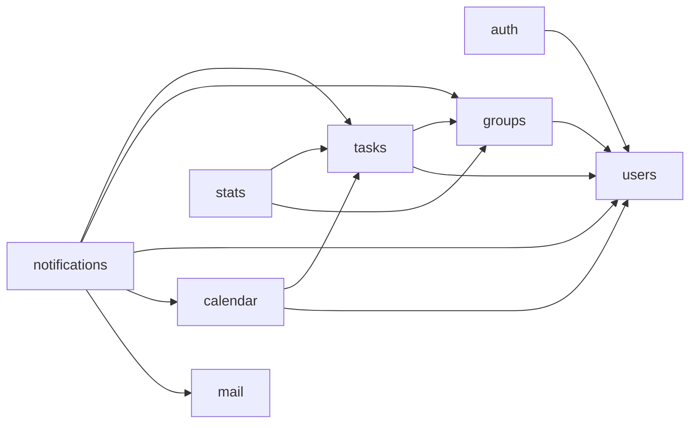
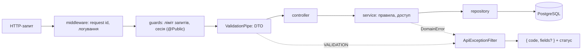

# Архітектура бекенду

Бекенд Errandly — **модульний моноліт**: один процес і одна база PostgreSQL, але бізнес-логіка розділена на модулі з чіткими межами. Кожен модуль — «чорна скринька» з публічним API, тому його можна змінювати незалежно, а за потреби й винести в окремий сервіс.

## Модулі

| Модуль          | Відповідальність                                                        | Таблиці                                                               | Вимоги              |
| --------------- | ----------------------------------------------------------------------- | --------------------------------------------------------------------- | ------------------- |
| `users`         | профіль: ім'я, email, часовий пояс, мова, аватарка; видалення акаунта   | `users`                                                               | FR-38, NFR-LEG-02   |
| `auth`          | реєстрація, вхід, сесії, пароль, вхід через Google, листи-підтвердження | `password_credentials`, `auth_identities`, `sessions`, `email_tokens` | FR-01–09            |
| `groups`        | групи, учасники, ролі, запрошення, відсутності                          | `groups`, `memberships`, `invites`, `absences`                        | FR-10–18            |
| `tasks`         | серії та екземпляри задач, статус, виконання, автоматичний розподіл     | `task_series`, `tasks`                                                | FR-19–31            |
| `calendar`      | підключення зовнішніх календарів і синхронізація                        | `calendar_connections`, `calendar_event_links`                        | FR-32–36, SYS-18–21 |
| `notifications` | сповіщення в сервісі, налаштування сповіщень, нагадування               | `notifications`, `notification_settings`, `notification_preferences`  | FR-25, FR-38        |
| `stats`         | статистика учасників (модель лише для читання поверх задач)             | —                                                                     | FR-37, FR-39        |
| `mail`          | шаблонні листи мовою одержувача                                         | —                                                                     | FR-04, FR-08, FR-38 |
| `health`        | перевірка живості й бази для Docker і CI                                | —                                                                     | SYS-27              |

Спільне ядро (не модулі, їх може використовувати будь-хто, а вони не залежать від модулів):

- `common/` — доменний словник (`domain.ts`), формат помилок, валідація, `Clock`, шина подій;
- `db/` — підключення, спільні колонки, збірка схеми для Drizzle, міграції та seed;
- `config/` — змінні середовища; `logger/` — структуровані логи.

### Структура модуля

```text
src/groups/
  index.ts                 публічне API: усе, що можна імпортувати ззовні
  groups.module.ts         Nest-модуль
  groups.controller.ts     HTTP: лише DTO → виклик сервісу
  groups.service.ts        бізнес-логіка й перевірка доступу (з'явиться з реалізацією)
  groups.rules.ts          інваріанти як чисті функції (assertNotLastAdmin, …)
  groups.repository.ts     усі запити Drizzle до таблиць модуля
  groups.schema.ts         таблиці модуля
  dto/                     контракт HTTP
```

### Правила меж (перевіряє `src/architecture.spec.ts`)

1. Модуль імпортує інший модуль **лише через його `index.ts`**. Сервіси, репозиторії й таблиці — внутрішні.
2. Виняток — файли `*.schema.ts`: вони можуть посилатися на таблиці інших модулів заради зовнішніх ключів. Це моноліт з однією базою, тож цілісність тримає PostgreSQL.
3. Запити до таблиці робить лише репозиторій модуля-власника. Чужі дані — через публічне API власника.
4. Між модулями немає циклів.
5. `common`, `config`, `logger` не залежать від модулів.

Тест працює як `ApplicationModules.verify()` у Spring Modulith: порушення падає в CI зі списком конкретних імпортів.

### Граф залежностей

Стрілка «A → B» означає, що A викликає публічне API B. Події йдуть у зворотний бік: B не знає про A, але A може слухати події B.



Висхідні модулі (`users`, `groups`) нічого не знають про низхідні (`tasks`, `calendar`, `notifications`). Тому, наприклад, `groups` не може викликати `tasks.redistribute()` — це утворило б цикл `groups ↔ tasks`. Натомість `groups` публікує подію, а `tasks` на неї реагує.

## Взаємодія модулів: гібридний підхід

Модулі спілкуються трьома способами. Вибір залежить від того, що потрібно викликачу.

| Спосіб                               | Коли                                                                                | Узгодженість                   | Приклад                                             |
| ------------------------------------ | ----------------------------------------------------------------------------------- | ------------------------------ | --------------------------------------------------- |
| **Публічне API** (синхронний виклик) | потрібна відповідь або рішення: запит, перевірка                                    | одразу, у тій самій транзакції | `tasks` питає `groups` про учасників і відсутності  |
| **Подія в транзакції**               | щось сталося, і реакція має бути узгоджена зі зміною; збій має скасувати все        | атомарно, у транзакції видавця | учасник вийшов → `tasks` перерозподіляє його задачі |
| **Подія після коміту**               | зовнішній побічний ефект, який може впасти й має повторюватися, не скасовуючи зміну | згодом, з повторами            | задачу призначено → синхронізація календаря, лист   |

Правило вибору: _«мені потрібна відповідь»_ → API; _«це сталося, і інші мають бути узгоджені»_ → подія в транзакції; _«це сталося, і зовнішній світ має дізнатися»_ → подія після коміту.

### Публічне API

Кожен модуль експортує з `index.ts` фасад (`GroupsApi`, `TasksApi`, …): `@Injectable()`-клас, який Nest-модуль додає в `exports`. Методи повертають прості типи або DTO, ніколи не рядки Drizzle, і приймають необов'язковий `DbExecutor`, щоб працювати в транзакції викликача.

Фасади (реалізовані й заплановані):

| Модуль     | Публічне API                                                                                                | Хто використовує                       |
| ---------- | ----------------------------------------------------------------------------------------------------------- | -------------------------------------- |
| `users`    | `UsersApi`: `findById`, `findByEmail`, `create`, `markEmailVerified` — ім'я, мова, часовий пояс для листів  | `auth`, згодом усі                     |
| `groups`   | `GroupsApi`: `requireMember(groupId, userId)` → роль, `requireAdmin(…)`, `members(groupId)` з відсутностями | `tasks`, `stats`, `notifications`      |
| `tasks`    | `findById`, `inRange(groupId, from, to)`, `dueBetween(from, to)`                                            | `calendar`, `notifications`, `stats`   |
| `calendar` | `status(userId)` → `CalendarStatusDto`                                                                      | `notifications` (сторінка налаштувань) |
| `mail`     | `MailService.send(template, to, data, locale)`                                                              | `notifications`, `auth`, `groups`      |

### Події

Шина подій — `common/events/event-bus.ts`. Видавець викликає `bus.publish(tx, 'group.memberLeft', payload)` **у транзакції своєї зміни** і не знає, хто слухає. Слухачі реєструються в `onModuleInit` свого модуля:

```ts
// tasks.module.ts — реакція, узгоджена зі зміною
bus.onInTransaction('group.memberLeft', (event, tx) =>
  this.assignment.redistribute(event.groupId, event.userId, tx),
);

// calendar.module.ts — побічний ефект із повторами; id слухача стабільний
bus.onAfterCommit('task.assigned', 'calendar.syncAssignment', (event) =>
  this.sync.syncTask(event.taskId),
);
```

Як працює доставка після коміту (реєстр публікацій подій, як у Spring Modulith):

1. `publish` пише в `event_publications` по рядку на кожного слухача — у тій самій транзакції, що й бізнес-зміна. Якщо зміна відкотилася, подій немає; якщо закомітилася, подія не загубиться.
2. `EventDispatcher` кожні `EVENTS_POLL_INTERVAL_MS` (2 с) забирає готові рядки (`FOR UPDATE SKIP LOCKED` з орендою на 5 хв, тож два екземпляри не доставлять подію двічі) і викликає слухача.
3. Успіх → `completed_at`. Збій → повтор через 30 с, 2 хв, 8 хв, 32 хв; після 5 спроб слухач здається (`next_attempt_at = null`, помилка в `last_error` і в лозі). Це вимога SYS-21: збій синхронізації не відкочує зміну й повторюється до 5 разів.
4. Слухачі після коміту мають бути **ідемпотентними**: подію може бути доставлено повторно.

```mermaid
sequenceDiagram
  autonumber
  participant G as groups.service
  participant DB as PostgreSQL
  participant T as tasks (у транзакції)
  participant D as EventDispatcher
  participant N as notifications (після коміту)

  G->>DB: BEGIN; DELETE membership
  G->>T: publish group.memberLeft
  T->>DB: перерозподіл задач (FR-15)
  G->>DB: INSERT event_publications (notifications.memberRemoved)
  G->>DB: COMMIT
  Note over G,DB: збій будь-де до COMMIT скасовує все разом
  D->>DB: забрати готові публікації
  D->>N: memberRemoved(event)
  N->>DB: сповіщення removedFromGroup
  D->>DB: completed_at = now()
```

```mermaid
sequenceDiagram
  autonumber
  participant T as tasks.service
  participant DB as PostgreSQL
  participant D as EventDispatcher
  participant C as calendar (після коміту)
  participant Gc as Google Calendar API

  T->>DB: BEGIN; UPDATE tasks SET assignee_id
  T->>DB: INSERT event_publications ×2 (calendar, notifications)
  T->>DB: COMMIT — користувач уже бачить нового виконавця
  D->>C: syncAssignment(event)
  C->>Gc: створити подію
  Gc-->>C: 503
  C-->>D: помилка
  D->>DB: attempts = 1, next_attempt_at = +30 с
  Note over D,Gc: після 5 невдач синхронізація стає paused, і налаштування показують банер
```

### Каталог подій

Payload — лише id, ISO-рядки й прості значення (`common/events/domain-events.ts`). Подія описує, **що сталося**, а не що робити далі.

| Подія                             | Видавець | Слухачі (режим)                                                                                                                                     |
| --------------------------------- | -------- | --------------------------------------------------------------------------------------------------------------------------------------------------- |
| `auth.emailVerificationRequested` | `auth`   | `auth` — новий токен і лист `verifyEmail` (після коміту, з повторами)                                                                               |
| `auth.passwordResetRequested`     | `auth`   | `auth` — новий токен на 1 год і лист `resetPassword` (після коміту, з повторами)                                                                    |
| `user.deleted`                    | `users`  | `groups` — `LAST_ADMIN`, якщо користувач — єдиний адмін групи з іншими учасниками, інакше вийти з усіх груп (у транзакції; далі `group.memberLeft`) |
| `group.created`                   | `groups` | `notifications` — `groupCreated` (після коміту, буде додано)                                                                                        |
| `group.roleChanged`               | `groups` | `notifications` — `roleGranted`/`roleRevoked` (після коміту, буде додано)                                                                           |
| `group.inviteEmailRequested`      | `groups` | `groups` — окреме посилання й лист `invite` одержувачу (після коміту, з повторами)                                                                  |
| `group.memberJoined`              | `groups` | `notifications` — `groupJoined` новачку, `memberJoined` адмінам (після коміту)                                                                      |
| `group.memberLeft`                | `groups` | `tasks` — перерозподіл відкритих задач (у транзакції, FR-15); `notifications` — `removedFromGroup` (після коміту)                                   |
| `group.absenceAdded`              | `groups` | `tasks` — перепризначити автоматично розподілені задачі на ці дні (у транзакції, FR-29)                                                             |
| `task.assigned`                   | `tasks`  | `notifications` — `taskAssigned`/`taskUnassigned` і лист (після коміту); `calendar` — подія в календарі (після коміту)                              |
| `task.changed`                    | `tasks`  | `calendar` — оновити подію (після коміту)                                                                                                           |
| `task.completed`                  | `tasks`  | `calendar` — позначити подію (після коміту)                                                                                                         |
| `task.deleted`                    | `tasks`  | `calendar` — видалити подію (після коміту)                                                                                                          |

Періодичні задачі — не події, а розклад (`@nestjs/schedule`): нагадування `taskDueSoon`, прострочення `taskOverdue`, тижневий підсумок, поповнення серій на 4 тижні вперед (SD-4).

## Обробка запиту



- **Контролери** лише приймають DTO й викликають сервіс. Логіки в них немає (ПР6, табл. 8).
- **Валідація**: `ValidationPipe` з `whitelist` і `forbidNonWhitelisted`. Кожне правило має код поля (`code('tooLong')`), а `validationExceptionFactory` повертає один код на поле.
- **Помилки**: сервіси кидають `DomainError('LAST_ADMIN', { groups })` і не знають про HTTP. `ApiExceptionFilter` — глобальний обробник (аналог `@RestControllerAdvice`), зареєстрований через `APP_FILTER`. Статус кожного коду визначено в одному місці, `ERROR_STATUS`, і TypeScript вимагає статус для кожного коду. Порушення унікальності чи зовнішнього ключа в PostgreSQL дає `409 CONFLICT`, будь-що інше — `500 INTERNAL` зі стеком у лозі.
- **Безпека** (SYS-06–07, NFR-SEC-03/06/07):
  - `SessionGuard` (модуль `auth`, `APP_GUARD`) — «заборонено за замовчуванням»: маршрут без `@Public()` вимагає чинної сесії, інакше `401 UNAUTHENTICATED`. `@CurrentUser()` дає `{ id, sessionId }`. Декоратори лежать у `common/http/auth.ts`, тож `users` користується ними, не імпортуючи `auth`.
  - Сесія — HttpOnly-cookie `errandly_session` (`SameSite=Lax`, `Path=/api`, `Secure` у production) з випадковим токеном на 256 біт; у базі лише його SHA-256. Строк — 30 днів від останнього використання, продовжується не частіше за раз на годину.
  - `ThrottlerGuard`: 100 запитів на хвилину з IP на будь-який маршрут і 10 — на вхід, реєстрацію, відновлення пароля й листи (`RATE_LIMIT_PER_MINUTE`, `AUTH_RATE_LIMIT_PER_MINUTE`), інакше `429 TOO_MANY_REQUESTS`. IP — з `X-Forwarded-For` (`trust proxy` для nginx). Блокування акаунта після 5 невдалих входів діє незалежно від IP.
  - `helmet` (заголовки безпеки) і перевірка `Origin`: запит, що змінює дані, з чужого origin отримує `403 FORBIDDEN` (захист від CSRF разом із `SameSite`).
  - Доступ до групи перевіряють сервіси через `GroupsApi` (`requireMember`, `requireAdmin`). Зміни ролей, вихід і видалення учасників блокують рядки членства групи (`SELECT … FOR UPDATE`), тож два паралельні запити не залишать групу без адміністратора.

## Порти та адаптери

Зовнішні залежності сховані за абстрактними класами, які в Nest водночас є токенами DI. Сервіси залежать від порту, а реалізацію підставляє модуль. У тестах підставляється фейк.

| Порт              | Реалізація              | Навіщо                                                                                 |
| ----------------- | ----------------------- | -------------------------------------------------------------------------------------- |
| `Clock`           | `SystemClock`           | статус, вікно скасування 24 год, повтори; у тестах `FixedClock`                        |
| `PasswordHasher`  | `Argon2PasswordHasher`  | argon2id з параметрами OWASP (NFR-SEC-01); алгоритм можна замінити без змін у сервісах |
| `MailTransport`   | `SmtpMailTransport`     | SMTP (Mailpit, Gmail); HTTP-провайдер — інша реалізація                                |
| `CalendarGateway` | `GoogleCalendarGateway` | `CalendarGateways.for(provider)` обирає шлюз за провайдером; Outlook — новий клас      |

## Логування

nestjs-pino пише JSON-логи з `X-Request-Id` (nginx передає його далі), кодом помилки контракту (`errorCode`) і без секретів: заголовки авторизації, cookie, паролі, токени й токени запрошень в URL замасковано. SQL пишеться на рівні `debug` без параметрів. `EventDispatcher` попереджає про кожен повтор і пише помилку, коли здається.
