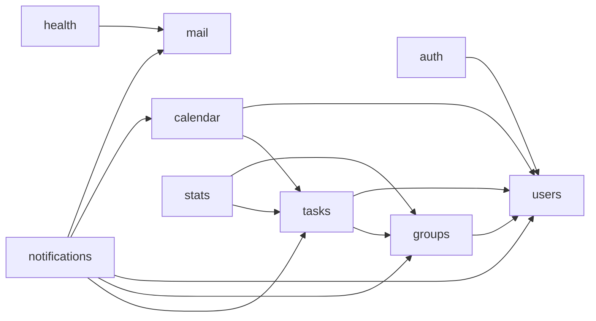
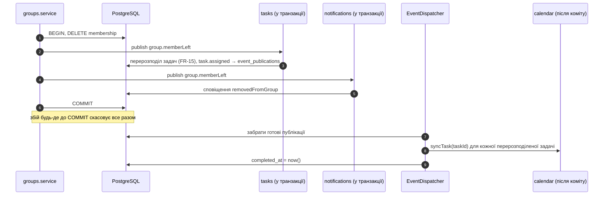
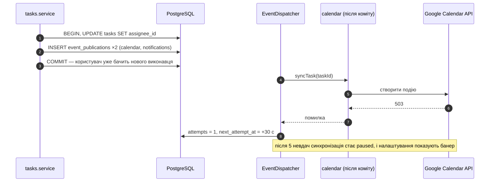
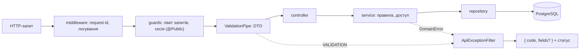

# Архітектура бекенду

Бекенд Errandly — **модульний моноліт**: один процес і одна база PostgreSQL, але бізнес-логіка розділена на модулі з чіткими межами. Кожен модуль — «чорна скринька» з публічним API, тому його можна змінювати незалежно, а за потреби й винести в окремий сервіс.

Діаграми послідовності, класів і компонентів — у [diagrams/](diagrams), вимоги — у [functional.md](requirements/functional.md), [non-functional.md](requirements/non-functional.md) і [system.md](requirements/system.md).

## Модулі

| Модуль          | Відповідальність                                                                     | Таблиці                                                                                                  | Вимоги              |
| --------------- | ------------------------------------------------------------------------------------ | -------------------------------------------------------------------------------------------------------- | ------------------- |
| `users`         | профіль: ім'я, email, часовий пояс, мова, аватарка; видалення акаунта                | `users`                                                                                                  | FR-38, NFR-LEG-02   |
| `auth`          | реєстрація, вхід, сесії, пароль, вхід через Google, листи-підтвердження              | `password_credentials`, `auth_identities`, `sessions`, `email_tokens`                                    | FR-01–09            |
| `groups`        | групи, учасники, ролі, запрошення, відсутності                                       | `groups`, `memberships`, `invites`, `absences`                                                           | FR-10–18            |
| `tasks`         | серії та екземпляри задач, статус, виконання, автоматичний розподіл, обмін           | `task_series`, `tasks`, `task_swaps`                                                                     | FR-19–31            |
| `calendar`      | підключення зовнішніх календарів і синхронізація                                     | `calendar_connections`, `calendar_settings`, `calendar_event_links`                                      | FR-32–36, SYS-18–21 |
| `notifications` | сповіщення в сервісі, налаштування сповіщень, нагадування, тижневий підсумок         | `notifications`, `notification_settings`, `notification_preferences`, `task_reminders`, `weekly_digests` | FR-25, FR-29, FR-38 |
| `stats`         | статистика учасників (модель лише для читання поверх задач)                          | —                                                                                                        | FR-37, FR-39        |
| `mail`          | шаблонні листи мовою одержувача                                                      | —                                                                                                        | FR-04, FR-08, FR-38 |
| `health`        | живість для Docker; готовність (база, сховище, пошта, доставка подій) для nginx і CI | —                                                                                                        | SYS-27              |

Спільне ядро (не модулі, їх може використовувати будь-хто, а вони не залежать від модулів):

- `common/` — доменний словник (`domain.ts`), формат помилок (`DomainError`, `requireFound`), валідація, `Clock` і `time.ts`, шина подій, HTTP-захист (`http/`: guard-и, ліміти, перевірка Origin), `ExclusiveRunner` для періодичних задач, `ShutdownState`, `DataRetention`, `defineTransitions` для дозволених змін статусу, `TokenCipher`, `ObjectStorage` і клієнт Google;
- `db/` — підключення, спільні колонки, збірка схеми для Drizzle, міграції та seed;
- `config/` — змінні середовища; `logger/` — структуровані логи.

### Структура модуля

```text
src/groups/
  index.ts                 публічне API: усе, що можна імпортувати ззовні
  groups.module.ts         Nest-модуль
  groups.controller.ts     HTTP: лише DTO → виклик сервісу
  groups.service.ts        бізнес-логіка й перевірка доступу (з'явиться з реалізацією)
  groups.rules.ts          інваріанти як чисті функції (assertNotLastAdmin, …)
  groups.repository.ts     усі запити Drizzle до таблиць модуля
  groups.schema.ts         таблиці модуля
  dto/                     контракт HTTP
```

### Правила меж (перевіряє `src/architecture.spec.ts`)

1. Модуль імпортує інший модуль **лише через його `index.ts`**. Сервіси, репозиторії й таблиці — внутрішні.
2. Виняток — файли `*.schema.ts`: вони можуть посилатися на таблиці інших модулів заради зовнішніх ключів. Це моноліт з однією базою, тож цілісність тримає PostgreSQL.
3. Запити до таблиці робить лише репозиторій модуля-власника. Чужі дані — через публічне API власника.
4. Між модулями немає циклів.
5. `common`, `config`, `logger` не залежать від модулів.

Тест працює як `ApplicationModules.verify()` у Spring Modulith: порушення падає в CI зі списком конкретних імпортів.

### Граф залежностей

Стрілка «A → B» означає, що A викликає публічне API B. Події йдуть у зворотний бік: B не знає про A, але A може слухати події B.



Висхідні модулі (`users`, `groups`) нічого не знають про низхідні (`tasks`, `calendar`, `notifications`). Тому, наприклад, `groups` не може викликати `tasks.redistribute()` — це утворило б цикл `groups ↔ tasks`. Натомість `groups` публікує подію, а `tasks` на неї реагує.

## Взаємодія модулів: гібридний підхід

Модулі спілкуються трьома способами. Вибір залежить від того, що потрібно викликачу.

| Спосіб                               | Коли                                                                                | Узгодженість                   | Приклад                                             |
| ------------------------------------ | ----------------------------------------------------------------------------------- | ------------------------------ | --------------------------------------------------- |
| **Публічне API** (синхронний виклик) | потрібна відповідь або рішення: запит, перевірка                                    | одразу, у тій самій транзакції | `tasks` питає `groups` про учасників і відсутності  |
| **Подія в транзакції**               | щось сталося, і реакція має бути узгоджена зі зміною; збій має скасувати все        | атомарно, у транзакції видавця | учасник вийшов → `tasks` перерозподіляє його задачі |
| **Подія після коміту**               | зовнішній побічний ефект, який може впасти й має повторюватися, не скасовуючи зміну | згодом, з повторами            | задачу призначено → синхронізація календаря, лист   |

Правило вибору: _«мені потрібна відповідь»_ → API; _«це сталося, і інші мають бути узгоджені»_ → подія в транзакції; _«це сталося, і зовнішній світ має дізнатися»_ → подія після коміту.

### Публічне API

Кожен модуль експортує з `index.ts` фасад (`GroupsApi`, `TasksApi`, …): `@Injectable()`-клас, який Nest-модуль додає в `exports`. Методи повертають прості типи або DTO, ніколи не рядки Drizzle, і приймають необов'язковий `DbExecutor`, щоб працювати в транзакції викликача.

Фасади (реалізовані й заплановані):

| Модуль     | Публічне API                                                                                                                                         | Хто використовує                       |
| ---------- | ---------------------------------------------------------------------------------------------------------------------------------------------------- | -------------------------------------- |
| `users`    | `UsersApi`: `findById`, `findByEmail`, `create`, `markEmailVerified` — ім'я, мова, часовий пояс для листів                                           | `auth`, згодом усі                     |
| `groups`   | `GroupsApi`: `requireMember(groupId, userId)` → роль, `requireAdmin(…)`, `members(groupId)` з відсутностями, `admins(groupId)`, `names(groupIds)`    | `tasks`, `stats`, `notifications`      |
| `tasks`    | `TasksApi`: `hold(taskId, tx)`, `find(taskId)`, `inGroup(groupId, from, to)`, `assignedTo(userId, from, until?)`, `openAssignedDueBetween(from, to)` | `calendar`, `notifications`, `stats`   |
| `calendar` | `CalendarApi`: `settings(userId)`, `setReminderMinutes(userId, minutes)`                                                                             | `notifications` (сторінка налаштувань) |
| `mail`     | `MailService.send(template, to, data, locale)`                                                                                                       | `notifications`, `auth`, `groups`      |

### Події

Шина подій — `common/events/event-bus.ts`. Видавець викликає `bus.publish(tx, 'group.memberLeft', payload)` **у транзакції своєї зміни** і не знає, хто слухає. Слухачі реєструються в `onModuleInit` свого модуля:

```ts
// tasks.module.ts — реакція, узгоджена зі зміною
bus.onInTransaction('group.memberLeft', (event, tx) =>
  this.assignment.redistribute(event.groupId, event.userId, tx),
);

// calendar.module.ts — побічний ефект із повторами; id слухача стабільний
bus.onAfterCommit('task.assigned', 'calendar.syncAssignedTask', (event) =>
  this.sync.syncTask(event.taskId),
);
```

Як працює доставка після коміту (реєстр публікацій подій, як у Spring Modulith):

1. `publish` пише в `event_publications` по рядку на кожного слухача — у тій самій транзакції, що й бізнес-зміна. Якщо зміна відкотилася, подій немає; якщо закомітилася, подія не загубиться.
2. `EventDispatcher` кожні `EVENTS_POLL_INTERVAL_MS` (2 с) забирає готові рядки (`FOR UPDATE SKIP LOCKED` з орендою на 5 хв, тож два екземпляри не доставлять подію двічі) і викликає слухача.
3. Успіх → `completed_at`. Збій → повтор через 30 с, 2 хв, 8 хв, 32 хв; після 5 спроб слухач здається (`next_attempt_at = null`, помилка в `last_error` і в лозі). Це вимога SYS-21: збій синхронізації не відкочує зміну й повторюється до 5 разів.
4. Слухачі після коміту мають бути **ідемпотентними**: подію може бути доставлено повторно.





### Каталог подій

Payload — лише id, ISO-рядки й прості значення (`common/events/domain-events.ts`). Подія описує, **що сталося**, а не що робити далі.

| Подія                             | Видавець        | Слухачі (режим)                                                                                                                                                                                                                                                                             |
| --------------------------------- | --------------- | ------------------------------------------------------------------------------------------------------------------------------------------------------------------------------------------------------------------------------------------------------------------------------------------- |
| `auth.emailVerificationRequested` | `auth`          | `auth` — новий токен і лист `verifyEmail` (після коміту, з повторами)                                                                                                                                                                                                                       |
| `auth.passwordResetRequested`     | `auth`          | `auth` — новий токен на 1 год і лист `resetPassword` (після коміту, з повторами)                                                                                                                                                                                                            |
| `user.deleted`                    | `users`         | `groups` — `LAST_ADMIN`, якщо користувач — єдиний адмін групи з іншими учасниками, інакше вийти з усіх груп (у транзакції; далі `group.memberLeft`); `calendar` — закрити підключення (у транзакції)                                                                                        |
| `user.avatarDiscarded`            | `users`         | `users` — видалити файл фото зі сховища (після коміту, з повторами): заміна, видалення фото чи акаунта                                                                                                                                                                                      |
| `group.created`                   | `groups`        | `notifications` — `groupCreated` автору (у транзакції)                                                                                                                                                                                                                                      |
| `group.roleChanged`               | `groups`        | `notifications` — `roleGranted`/`roleRevoked`, якщо роль змінив хтось інший (у транзакції)                                                                                                                                                                                                  |
| `group.inviteEmailRequested`      | `groups`        | `groups` — окреме посилання й лист `invite` одержувачу (після коміту, з повторами)                                                                                                                                                                                                          |
| `group.memberJoined`              | `groups`        | `notifications` — `groupJoined` новачку, `memberJoined` адмінам (у транзакції)                                                                                                                                                                                                              |
| `group.memberLeft`                | `groups`        | `tasks` — відкриті задачі, і ручні теж, отримують нового виконавця, серії учасника — автоматичний розподіл (у транзакції, FR-15); `notifications` — `removedFromGroup`, якщо учасника видалив адмін (у транзакції)                                                                          |
| `group.absenceAdded`              | `groups`        | `tasks` — автоматично розподілені задачі на ці дні отримують нового виконавця, ручні лишаються (у транзакції, FR-17, FR-29)                                                                                                                                                                 |
| `group.deleted`                   | `groups`        | `tasks` — видалити всі задачі групи через `task.deleted` (у транзакції, до видалення групи)                                                                                                                                                                                                 |
| `task.assigned`                   | `tasks`         | `calendar` — звірити подію з виконавцем (після коміту); `notifications` — `taskAssigned`/`taskUnassigned`, а без виконавця — `taskNoAssignee` адмінам (у транзакції), і лист `taskAssigned` (після коміту); `bulk` (усі екземпляри нової серії, крім першого, і поповнення) не оголошується |
| `task.changed`                    | `tasks`         | `calendar` — оновити подію (після коміту)                                                                                                                                                                                                                                                   |
| `task.completed`                  | `tasks`         | `calendar` — «✓» і без нагадування або назад (після коміту)                                                                                                                                                                                                                                 |
| `task.swapProposed`               | `tasks`         | `notifications` — `swapProposed` одержувачу (у транзакції)                                                                                                                                                                                                                                  |
| `task.swapDecided`                | `tasks`         | `notifications` — `swapAccepted`/`swapDeclined` автору (у транзакції); виконавців уже змінили два `task.assigned`                                                                                                                                                                           |
| `task.deleted`                    | `tasks`         | `calendar` — поки зв'язки з подіями ще є, поставити їх у чергу на видалення (у транзакції, до видалення задачі)                                                                                                                                                                             |
| `notification.reminderDue`        | `notifications` | `notifications` — лист `taskDueSoon` або `taskOverdue`, якщо задача досі цього виконавця й не виконана, а лист не вимкнено (після коміту, з повторами)                                                                                                                                      |
| `notification.digestDue`          | `notifications` | `notifications` — лист `weeklyDigest` (після коміту, з повторами)                                                                                                                                                                                                                           |
| `calendar.eventDiscarded`         | `calendar`      | `calendar` — видалити подію в Google (після коміту)                                                                                                                                                                                                                                         |
| `calendar.resyncRequested`        | `calendar`      | `calendar` — звірити весь календар: майбутні задачі, події без зв'язку (після коміту)                                                                                                                                                                                                       |
| `calendar.connectionClosed`       | `calendar`      | `calendar` — видалити календар «Errandly» і відкликати доступ (після коміту)                                                                                                                                                                                                                |

Періодичні задачі — не події, а розклад (`@nestjs/schedule`, вимикається `SCHEDULER_ENABLED=false`). Уже є `SeriesTopUp`: щогодини й під час старту доповнює повторювані серії до 4 тижнів уперед; повторний запуск нічого не дублює (ключ `(series_id, due_at)`), тож пропущені після збою запуски наздоганяються одразу (SYS-25). `ReminderJobs` — кожні 5 хвилин і під час старту (SD-4): нагадування «скоро термін» за часом із налаштувань виконавця (FR-38), прострочення за останні 2 доби — сповіщення `taskOverdue` і лист (FR-25), тижневий підсумок у понеділок від 09:00 за поясом користувача. Що вже надіслано, записують `task_reminders` і `weekly_digests`, тож повторний запуск нічого не дублює, а пропущені після збою наздоганяються (SYS-25). Самі листи йдуть подіями `notification.*` через `event_publications` з повторами. `DataRetention` щоночі о 03:00 і під час старту запускає очищення, яке кожен модуль реєструє для своїх таблиць у `onModuleInit` (строки — у [data-model.md](data-model.md#строки-зберігання-nfr-leg-01)).

## Обробка запиту



- **Контролери** лише приймають DTO й викликають сервіс. Логіки в них немає (ПР6, табл. 8).
- **Валідація**: `ValidationPipe` з `whitelist` і `forbidNonWhitelisted`. Кожне правило має код поля (`code('tooLong')`), а `validationExceptionFactory` повертає один код на поле.
- **Помилки**: сервіси кидають `DomainError('LAST_ADMIN', { groups })` і не знають про HTTP. `ApiExceptionFilter` — глобальний обробник (аналог `@RestControllerAdvice`), зареєстрований через `APP_FILTER`. Статус кожного коду визначено в одному місці, `ERROR_STATUS`, і TypeScript вимагає статус для кожного коду. Порушення унікальності чи зовнішнього ключа в PostgreSQL дає `409 CONFLICT`, будь-що інше — `500 INTERNAL` зі стеком у лозі.
- **Безпека** (SYS-06–07, NFR-SEC-03/06/07):
  - Три глобальні guard-и (модуль `auth`, `APP_GUARD`) у порядку реєстрації: `SessionGuard` дізнається з cookie, хто викликає; `CallerThrottlerGuard` рахує запит; `AuthenticatedGuard` — «заборонено за замовчуванням»: маршрут без `@Public()` вимагає чинної сесії, інакше `401 UNAUTHENTICATED`. `@CurrentUser()` дає `{ id, sessionId }`. Декоратори лежать у `common/http/auth.ts`, тож `users` користується ними, не імпортуючи `auth`.
  - Сесія — HttpOnly-cookie `errandly_session` (`SameSite=Lax`, `Path=/api`, `Secure` у production) з випадковим токеном на 256 біт; у базі лише його SHA-256. Строк — 30 днів від останнього використання, продовжується не частіше за раз на годину.
  - `CallerThrottlerGuard` (`common/http/rate-limit.ts`, підклас `ThrottlerGuard`): 100 запитів на хвилину на будь-який маршрут і 10 — на маршрути з `@StrictRateLimit()`: вхід, реєстрацію, відновлення й зміну пароля, листи, запрошення, видалення акаунта, завантаження аватарки й виклики Google (`RATE_LIMIT_PER_MINUTE`, `AUTH_RATE_LIMIT_PER_MINUTE`), інакше `429 TOO_MANY_REQUESTS` з `Retry-After` і `retryAfterSeconds`. Користувача з сесією рахує за акаунтом, бо сусіди зазвичай ділять одну домашню IP; решту, і відхилені запити теж, — за IP з `X-Forwarded-For` (`trust proxy` для nginx). Лічильники в пам'яті процесу, чого досить для одного екземпляра бекенду. Блокування акаунта після 5 невдалих входів діє незалежно від IP.
  - `helmet` (заголовки безпеки) і перевірка `Origin`: запит, що змінює дані, з чужого origin отримує `403 FORBIDDEN` (захист від CSRF разом із `SameSite`).
  - nginx (`frontend/nginx.conf`, образ `nginx-unprivileged`) віддає SPA із власними заголовками (`frontend/security-headers.conf`: CSP, `X-Frame-Options: DENY`, `Referrer-Policy`, `Permissions-Policy`), бо ці файли до Nest не доходять. Перед `/api` він обмежує 20 запитів/с з IP (запас 40) і тіло запиту до 1 МБ; відмови мають формат API: `429 TOO_MANY_REQUESTS` з `Retry-After` і `413 FILE_TOO_LARGE`.
  - Доступ до групи перевіряють сервіси через `GroupsApi` (`requireMember`, `requireAdmin`). Зміни ролей, вихід і видалення учасників блокують рядки членства групи (`SELECT … FOR UPDATE`), тож два паралельні запити не залишать групу без адміністратора. Прийняття обміну блокує пропозицію, а потім обидві задачі в порядку `id`, тож два обміни з однією задачею не зміняться навхрест і не заблокують один одного (SYS-13).

## Порти та адаптери

Зовнішні залежності сховані за абстрактними класами, які в Nest водночас є токенами DI. Сервіси залежать від порту, а реалізацію підставляє модуль. У тестах підставляється фейк.

OAuth-клієнт Google (`common/google/google-clients.ts`, `GoogleClients`) спільний для входу й календаря, тому лежить у спільному ядрі: кожен потік отримує свій клієнт зі своєю адресою повернення (`oauthClient(callbackPath)`), а виклики API від імені користувача — `client(refreshToken)`: один клієнт на refresh-токен (до 200 останніх), тож access-токен служить свою годину, а не оновлюється перед кожним запитом.

| Порт                 | Реалізація                  | Навіщо                                                                                                                                                                                   |
| -------------------- | --------------------------- | ---------------------------------------------------------------------------------------------------------------------------------------------------------------------------------------- |
| `Clock`              | `SystemClock`               | статус, вікно скасування 24 год, повтори; у тестах `FixedClock`                                                                                                                          |
| `PasswordHasher`     | `Argon2PasswordHasher`      | argon2id з параметрами OWASP (NFR-SEC-01); алгоритм можна замінити без змін у сервісах                                                                                                   |
| `MailTransport`      | `SmtpMailTransport`         | SMTP (Mailpit, Gmail); HTTP-провайдер — інша реалізація                                                                                                                                  |
| `ObjectStorage`      | `S3ObjectStorage`           | файли поза базою (аватарки) через S3 API: SeaweedFS у compose; R2, AWS S3 чи Supabase Storage — лише інші `S3_*`                                                                         |
| `CalendarGateway`    | `GoogleCalendarGateway`     | `CalendarGateways.for(provider)` обирає шлюз за провайдером; Outlook — новий клас                                                                                                        |
| `CalendarOAuth`      | `GoogleCalendarOAuth`       | згода на календар (`calendar.app.created`), обмін коду на refresh-токен, відкликання                                                                                                     |
| `OAuthSignIn`        | `GoogleOAuthSignIn`         | вхід через провайдера (FR-07): `SignInProviders.for(provider)` — `Record<AuthProvider, OAuthSignIn>`, тож новий провайдер без адаптера не компілюється; Microsoft чи GitHub — новий клас |
| `AssignmentStrategy` | `LeastLoadRotationStrategy` | алгоритм розподілу (FR-27–29) окремо від сервісу задач; інший алгоритм — інший клас                                                                                                      |

## Зупинка й тайм-аути

На SIGTERM чи SIGINT (у compose `init: true`, тож сигнал доходить до Node) Nest проходить фази в такому порядку:

1. `onModuleDestroy`: `ShutdownState` вмикає `shutdownGate`, тож нові запити отримують `503 SERVICE_UNAVAILABLE` з `Connection: close`.
2. `beforeApplicationShutdown`: `EventDispatcher`, `SeriesTopUp`, `ReminderJobs` і `DataRetention` не починають нового запуску й чекають поточний (`ExclusiveRunner.stop()`). Диспетчер доставляє подію, яку вже почав, а решту пачки повертає в чергу без очікування оренди.
3. HTTP-сервер закривається, щойно відповість на запити, що вже виконуються.
4. `onApplicationShutdown`: закриваються SMTP і S3, останнім — пул PostgreSQL.

Якщо зупинка триває довше за `SHUTDOWN_TIMEOUT_MS` (20 с, менше за `stop_grace_period: 30s` у compose), процес виходить з кодом 1.

Тайм-аути зовнішніх викликів не дають одному завислому з'єднанню тримати запит, доставку чи зупинку:

| Що           | Тайм-аути                                                                                                     |
| ------------ | ------------------------------------------------------------------------------------------------------------- |
| HTTP-сервер  | заголовки — 15 с, увесь запит — 30 с                                                                          |
| PostgreSQL   | з'єднання — 5 с, запит — 30 с, транзакція без дій — 60 с (CLI-скрипти міграцій працюють без цих лімітів)      |
| SMTP         | з'єднання й привітання — 10 с, сокет — 30 с; у production справжній сервер без `SMTP_SECURE` вимагає STARTTLS |
| S3           | з'єднання — 5 с, запит — 15 с                                                                                 |
| Google API   | 10 с                                                                                                          |
| Health-проби | 3 с кожна                                                                                                     |

## Логування

nestjs-pino пише JSON-логи з `X-Request-Id` (nginx передає його далі), кодом помилки контракту (`errorCode`) і без секретів: заголовки авторизації, cookie, паролі, токени, токени запрошень і OAuth-параметри `code`/`state` в URL замасковано. SQL пишеться на рівні `debug` без параметрів. `EventDispatcher` попереджає про кожен повтор і пише помилку, коли здається.
