# Модель даних

Таблиці PostgreSQL, їхні зв'язки та рішення щодо зберігання. Джерело правди — схема Drizzle у `backend/src/<модуль>/<модуль>.schema.ts`; цей документ пояснює, навіщо вона така. Поняття й правила застосунку описано в [domain.md](domain.md), модулі — в [architecture.md](architecture.md), роботу з базою (угоди, міграції, seed) — у [database.md](database.md).

Сутності в коді — дані: типи рядків, виведені зі схеми (`TaskRow`, `UserRow`). Поведінку мають сервіси модулів, а інваріанти записано як чисті функції в `<модуль>.rules.ts`.

## ER-діаграма

```mermaid
erDiagram
  users ||--o| password_credentials : "вхід паролем"
  users ||--o{ auth_identities : "зовнішні акаунти"
  users ||--o{ sessions : ""
  users ||--o{ email_tokens : ""
  users ||--o{ memberships : ""
  groups ||--o{ memberships : ""
  memberships ||--o{ absences : ""
  groups ||--o{ invites : ""
  groups ||--o{ task_series : ""
  task_series ||--o{ tasks : "екземпляри"
  users |o--o{ tasks : "виконавець"
  tasks ||--o{ task_swaps : "віддають / просять"
  users ||--o{ task_swaps : "автор / одержувач"
  users ||--o{ notifications : ""
  users ||--o| notification_settings : ""
  users ||--o{ notification_preferences : ""
  tasks ||--o{ task_reminders : "надіслані нагадування"
  users ||--o{ weekly_digests : "надіслані підсумки"
  users ||--o| calendar_settings : ""
  users ||--o{ calendar_connections : ""
  calendar_connections ||--o{ calendar_event_links : ""
  tasks ||--o{ calendar_event_links : ""

  users {
    uuid id PK
    varchar name
    varchar email UK "у нижньому регістрі"
    timestamptz email_verified_at
    text timezone "IANA"
    boolean timezone_auto "стежить за пристроєм"
    locale locale "uk | en"
    text provider_avatar_url "фото від Google"
    text uploaded_avatar_key "своє фото в сховищі"
  }
  password_credentials {
    uuid user_id PK
    text password_hash "argon2id"
    smallint failed_logins
    timestamptz locked_until
  }
  auth_identities {
    uuid id PK
    uuid user_id FK
    auth_provider provider "google"
    text provider_user_id
  }
  sessions {
    text id PK "SHA-256 токена"
    uuid user_id FK
    timestamptz expires_at
  }
  email_tokens {
    uuid id PK
    uuid user_id FK
    email_token_purpose purpose
    text token_hash UK
    timestamptz expires_at
    timestamptz used_at
  }
  groups {
    uuid id PK
    varchar name
  }
  memberships {
    uuid group_id PK
    uuid user_id PK
    group_role role "admin | member"
    varchar color
  }
  absences {
    uuid id PK
    uuid group_id FK
    uuid user_id FK
    date starts_on
    date ends_on
  }
  invites {
    uuid id PK
    uuid group_id FK
    text token_hash UK
    timestamptz expires_at
    timestamptz revoked_at
  }
  task_series {
    uuid id PK
    uuid group_id FK
    recurrence_type recurrence_type
    smallint_array weekdays "1 = пн … 7 = нд"
    timestamptz starts_at
    timestamptz materialized_until
    text timezone "пояс автора"
    uuid assignee_id FK "null — автоматично"
    timestamptz ended_at
  }
  tasks {
    uuid id PK
    uuid series_id FK
    uuid group_id FK
    varchar title
    timestamptz due_at
    smallint difficulty "1–5"
    uuid assignee_id FK
    boolean manually_assigned
    timestamptz completed_at
  }
  task_swaps {
    uuid id PK
    uuid group_id FK
    uuid offered_task_id FK
    uuid requested_task_id FK
    uuid proposer_id FK
    uuid recipient_id FK
    swap_status status
    timestamptz decided_at
  }
  notifications {
    uuid id PK
    uuid user_id FK
    notification_type type
    jsonb data
    timestamptz read_at
  }
  notification_settings {
    uuid user_id PK
    smallint reminder_minutes
  }
  notification_preferences {
    uuid user_id PK
    notification_event event PK
    notification_channel channel PK
    boolean enabled
  }
  task_reminders {
    uuid task_id PK
    uuid user_id PK
    reminder_kind kind PK
    timestamptz due_at PK
  }
  weekly_digests {
    uuid user_id PK
    date week_start PK
  }
  calendar_connections {
    uuid id PK
    uuid user_id FK
    calendar_provider provider "google"
    text calendar_id
    sync_status sync_status "ok | paused"
    smallint failed_attempts
  }
  calendar_settings {
    uuid user_id PK
    smallint reminder_minutes
  }
  calendar_event_links {
    uuid connection_id PK
    uuid task_id PK
    text external_event_id
  }
```

Окремо від предметної області існує `event_publications`, реєстр подій між модулями ([architecture.md](architecture.md#події)).

## Таблиці за модулями

### users

- **User** — людина: профіль, мова інтерфейсу й листів, часовий пояс, аватарка. `timezone_auto` означає, що фронтенд тримає `timezone` рівним поясу пристрою; `false` — пояс обрано вручну. Те, як людина входить, сюди не входить: новий спосіб входу не змінює таблицю `users`. Аватарка — своє завантажене фото (`uploaded_avatar_key`, файл в об'єктному сховищі), інакше фото від Google (`provider_avatar_url`), інакше ініціали.

### auth

- **PasswordCredentials** — вхід за email і паролем: хеш argon2id і блокування після 5 невдалих спроб на 15 хвилин (`ACCOUNT_LOCKED` + `retryAfterSeconds`). Акаунт лише з Google такого рядка не має.
- **AuthIdentity** — прив'язаний зовнішній акаунт (`provider`, `provider_user_id`). Сьогодні це Google; Apple чи Microsoft — нове значення переліку й новий адаптер `OAuthSignIn`. Один запис має щонайбільше один акаунт кожного провайдера (`auth_identities_user_provider_key`), а `email` тут — лише довідково, востаннє отриманий від провайдера.
- **Session** — cookie-сесія. У cookie лежить випадковий токен, у базі — лише його SHA-256 (SYS-24).
- **EmailToken** — одноразове посилання з листа: підтвердження email або відновлення пароля (діє 1 год).

### groups

- **Group** — корінь агрегату: учасники, запрошення й серії задач не існують без групи.
- **Membership** — зв'язок «багато до багатьох» між User і Group з роллю й кольором (перший вільний з палітри). **Інваріант:** у групі завжди є принаймні один адміністратор (`LAST_ADMIN`). Група без учасників видаляється.
- **Absence** — період, коли учасник не отримує задач. Включні дати `yyyy-mm-dd`, `starts_on ≤ ends_on`. Видаляється разом із членством.
- **Invite** — посилання-запрошення на 7 днів, багаторазове. Зберігається лише хеш токена. Запрошення листом — окремий рядок з `email` одержувача; новий лист на ту саму адресу відкликає попередній (`revoked_at`).

### tasks

- **TaskSeries** — правило повторення: `once`, `daily`, `weekly` (дні тижня 1–7, принаймні один) або `monthly`. Одноразова задача — серія з одним екземпляром. `timezone` — пояс адміністратора, який створив серію (SYS-15): екземпляри тримають місцевий час і після переходу на зимовий. `assignee_id` — виконавець кожного нового екземпляра, `null` — автоматичний розподіл. `ended_at` — серію видалено, але виконані екземпляри лишилися; поповнення її пропускає.
- **Task** — конкретний екземпляр із терміном. Назву, опис і складність скопійовано із серії, тому редагування зі `scope=one` не зачіпає інших екземплярів. Пара `(series_id, due_at)` унікальна, тож повторне поповнення серії не створює дублікатів.
- **TaskSwap** — пропозиція обміну (FR-26): `offered_task_id` — задача автора, `requested_task_id` — задача одержувача. `status` — рішення (`pending` → `accepted` | `declined` | `cancelled`), а чи діє ще `pending`, обчислюється з обох задач, тож застарілі пропозиції не треба прибирати. Одна `pending` на пару задач (частковий унікальний індекс); видаляється разом із будь-якою із задач.
- **Статус не зберігається**, а обчислюється в такому порядку: `done` (є `completed_at`) → `overdue` (термін минув) → `unassigned` (немає виконавця) → `planned`.

### notifications

- **Notification** — запис у «дзвіночку». Типи: `groupCreated`, `groupJoined`, `memberJoined`, `taskAssigned`, `taskUnassigned`, `taskOverdue`, `roleGranted`, `roleRevoked`, `removedFromGroup`, `swapProposed`, `swapAccepted`, `swapDeclined`, `taskNoAssignee`. Отримувач ніколи не отримує сповіщення про власну дію.
- **NotificationSettings** — за скільки хвилин до терміну приходить лист «Скоро термін» (15, 30, 60, 180 або 1440; типово доба, FR-38).
- **TaskReminder** — уже надіслане нагадування `dueSoon` чи `overdue` для пари «задача × виконавець» і конкретного `due_at`. Фоновий процес не надсилає його вдруге, а новий термін дозволяє нове нагадування.
- **WeeklyDigest** — уже надісланий тижневий підсумок; `week_start` — понеділок за поясом користувача.
- **NotificationPreference** — увімкнено чи вимкнено подію (`taskAssigned`, `taskDueSoon`, `taskOverdue`, `weeklyDigest`) у каналі (`email`). Зберігаються лише відхилення від типових значень, тому нова подія чи канал — це значення переліку, а не нова колонка.

### calendar

- **CalendarConnection** — підключений зовнішній календар, окремий OAuth-потік від входу (SYS-18). `calendar_id` — власний календар «Errandly» у Google-акаунті. Зберігається лише refresh-токен, зашифрований AES-256-GCM. Після 5 невдач поспіль синхронізація переходить у `paused`, і налаштування показують банер.
- **CalendarSettings** — нагадування в кожній події календаря (15, 30, 60, 180 або 1440; типово година, FR-33). Окремо від підключення, тож не губиться після відключення.
- **CalendarEventLink** — подія, яку створив Errandly, для пари «підключення × задача» (SYS-19). Видаляється разом із задачею, але перед цим `task.deleted` встигає поставити в чергу видалення події.

## Строки зберігання (NFR-LEG-01)

Дані зберігаються, лише поки ними користуються. Щоночі о 03:00 і під час старту `DataRetention` (`common/retention.ts`) запускає очищення кожного модуля, і модуль видаляє рядки лише зі своїх таблиць. Строки задано константами в коді модулів.

| Таблиця              | Що видаляється                                                   | Чому                                                                               |
| -------------------- | ---------------------------------------------------------------- | ---------------------------------------------------------------------------------- |
| `sessions`           | прострочені                                                      | уже не відкривають сесію                                                           |
| `email_tokens`       | використані або прострочені                                      | посилання вже не діє                                                               |
| `invites`            | прострочені чи відкликані понад 30 днів тому                     | 30 днів посилання ще відповідає «Запрошення недійсне» (FR-13), потім 410 і так     |
| `absences`           | що закінчилися понад 30 днів тому                                | на розподіл уже не впливають, а показують, коли людини не було вдома               |
| `notifications`      | прочитані, старші за 30 днів; будь-які, старші за 90 днів        | дзвіночок показує лише 50 найновіших, а в `data` — імена й назви інших людей       |
| `task_reminders`     | для задач із терміном понад 7 днів тому                          | нагадування дивляться щонайбільше на 2 доби назад                                  |
| `weekly_digests`     | за тижні, що почалися понад 4 тижні тому                         | повторний підсумок стримує лише запис поточного тижня                              |
| `event_publications` | доставлені понад 7 днів тому; ті, на яких слухач здався, — за 30 | у `payload` — email запрошених і зашифровані refresh-токени; невдалі — для розбору |

Резервні копії мають зберігатися 7 діб (NFR-REL-06), тож видалене зникатиме й з них за тиждень (NFR-LEG-02).

## Похідні об'єкти (не зберігаються)

- **TaskStatus** — див. вище.
- **MemberStats** — для кожного учасника за тиждень або місяць: виконано, прострочено, сума складності виконаних. Обчислює модуль `stats` з даних `tasks`.

## Переліки

Значення — у `backend/src/common/domain.ts`; той самий список використовують таблиці, DTO й валідатори, тож вони не можуть розійтися.

| Перелік                | Значення                                                     |
| ---------------------- | ------------------------------------------------------------ |
| `locale`               | `uk` (типова), `en`                                          |
| `group_role`           | `admin`, `member`                                            |
| `recurrence_type`      | `once`, `daily`, `weekly`, `monthly`                         |
| `swap_status`          | `pending`, `accepted`, `declined`, `cancelled`               |
| `auth_provider`        | `google`                                                     |
| `calendar_provider`    | `google`                                                     |
| `sync_status`          | `ok`, `paused`                                               |
| `notification_event`   | `taskAssigned`, `taskDueSoon`, `taskOverdue`, `weeklyDigest` |
| `reminder_kind`        | `dueSoon`, `overdue`                                         |
| `notification_channel` | `email`                                                      |
| `email_token_purpose`  | `verifyEmail`, `resetPassword`                               |
