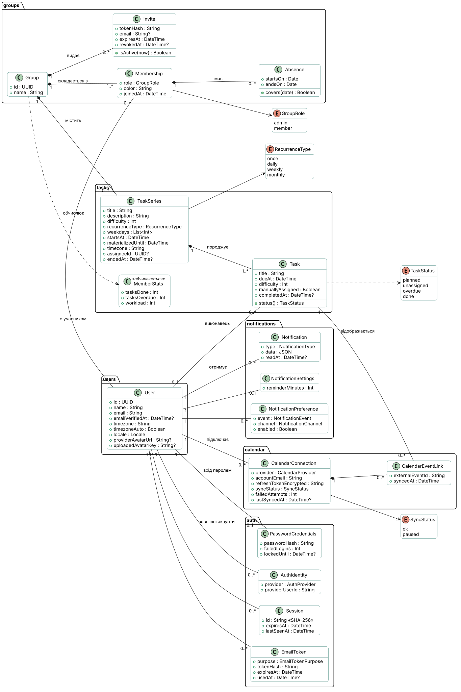

# Предметна область

Що таке Errandly з погляду користувача: поняття, правила й життєві цикли. Таблиці та зберігання описано в [data-model.md](data-model.md), модулі — в [architecture.md](architecture.md), вимоги — у [functional.md](requirements/functional.md).

## Для кого й навіщо

Errandly допомагає співмешканцям — квартира, кімната в гуртожитку — чесно ділити побутові задачі. Група — це спільне господарство: її учасники бачать задачі, хто й коли їх виконує, і статистику. Система сама призначає виконавця з найменшим навантаженням, нагадує про терміни й показує задачі в Google Calendar кожного учасника (ПР1, ПР2).

## Словник

| Поняття                  | Значення                                                                                                                         |
| ------------------------ | -------------------------------------------------------------------------------------------------------------------------------- |
| **Користувач**           | Людина з обліковим записом: ім'я, email, часовий пояс, мова (`uk` або `en`), аватарка. Входить паролем, а згодом і через Google. |
| **Група**                | Спільне господарство з назвою до 50 символів. Користувач може бути в кількох групах (FR-18).                                     |
| **Учасник**              | Користувач у групі. Має роль і власний колір у календарі групи.                                                                  |
| **Адміністратор**        | Учасник, який керує складом групи та задачами. Творець групи стає першим адміністратором; роль можна передати іншим.             |
| **Запрошення**           | Посилання, за яким можна приєднатися до групи. Діє 7 днів, будь-яку кількість разів. Можна надіслати й листом.                   |
| **Відсутність**          | Період (дати включно), коли учасник не вдома й не отримує нових задач (FR-17).                                                   |
| **Задача**               | Конкретна справа з терміном, складністю 1–5 і виконавцем, наприклад «Винести сміття, четвер 20:00».                              |
| **Серія**                | Правило повторення задачі: одноразова, щодня, щотижня у вибрані дні або щомісяця. Кожне повторення — окрема задача (екземпляр).  |
| **Навантаження**         | Сума складності задач учасника за останні 4 тижні. За ним система обирає виконавця.                                              |
| **Розподіл**             | Призначення виконавця: автоматичне (за навантаженням і ротацією) або ручне — його робить адміністратор.                          |
| **Статус задачі**        | «Заплановано», «Виконано», «Прострочено» або «Не призначено». Обчислюється, а не зберігається.                                   |
| **Нагадування**          | Сповіщення за обраний час до терміну: 15 хв, 30 хв, 1 год, 3 год або 1 добу.                                                     |
| **Сповіщення**           | Запис у «дзвіночку» застосунку, а для частини подій ще й лист. Кожен тип листів можна вимкнути (FR-38).                          |
| **Підключений календар** | Google Calendar учасника, куди Errandly додає його задачі. Підключається окремо від входу через Google (SYS-06).                 |
| **Статистика**           | Для кожного учасника за тиждень або місяць: виконано, прострочено, сумарна складність (FR-39).                                   |

## Агрегати та інваріанти

- **Група** — корінь агрегату: учасники, відсутності, запрошення й серії задач не існують без неї.
  - У групі завжди є принаймні один адміністратор. Єдиний адміністратор не може піти чи втратити роль, поки в групі є інші учасники (`LAST_ADMIN`). Те саме блокує видалення його облікового запису.
  - Коли групу залишає останній учасник, вона видаляється разом із задачами й запрошеннями.
  - Дані групи бачать лише її учасники; сторонній отримує відмову без даних, навіть не дізнавшись, чи група існує (NFR-SEC-04).
- **Задача** належить рівно одній групі й серії.
  - Виконану задачу не перепризначають (FR-31).
  - Ручне призначення автоматичний розподіл ніколи не перезаписує (FR-30).
  - Позначити задачу виконаною може лише її виконавець (FR-24).
- **Користувач** може видалити свій обліковий запис разом з особистими даними й аватаркою (NFR-LEG-02).

## Правила застосунку

- **Розподіл (FR-27–29).** Серед доступних учасників (не у відсутності в день терміну) обирається той, у кого найменше навантаження. За рівності — той, хто найдовше не виконував саме цю задачу (ротація). Якщо доступних немає, задача лишається «Не призначено», і адміністратори отримують сповіщення.
- **Статус** обчислюється в такому порядку: «Виконано» (є час виконання) → «Прострочено» (термін минув) → «Не призначено» (немає виконавця) → «Заплановано».
- **Повторювані задачі (FR-21).** Екземпляри створюються на 4 тижні наперед і щогодини доповнюються; повторне доповнення не створює дублікатів. Серія живе за годинником адміністратора, який її створив: «щочетверга о 20:00» лишається 20:00 і після переходу на зимовий час. Кожен учасник бачить той самий момент у своєму часовому поясі.
- **Редагування й видалення (FR-22)** серії стосуються або одного екземпляра, або всіх майбутніх невиконаних. Виконані задачі лишаються в історії.
- **Скасування виконання (FR-24).** Виконавець може зняти позначку протягом 24 годин, адміністратор — будь-коли.
- **Сповіщення.** Ніхто не отримує сповіщення про власну дію. Листи йдуть мовою одержувача.
- **Календар (FR-33–36).** Errandly створює й оновлює лише власні події та ніколи не чіпає інших. Якщо Google недоступний, зміна в застосунку зберігається, а синхронізація повторюється; після 5 невдач вона призупиняється, і користувач бачить банер (FR-35).
- **Час** зберігається в UTC, а показується в часовому поясі профілю (NFR-COMP-03): «автоматично» — пояс пристрою, або обраний вручну, щоб у подорожі бачити домашній час. Від нього ж залежать «сьогодні» й межі тижня в застосунку, а листи приходять за поясом одержувача. Серія задач має свій пояс — автора, тож її час не залежить від того, хто дивиться.

## Життєві цикли

**Обліковий запис:** реєстрація → підтвердження email (без нього не можна створювати групи й приймати запрошення, FR-04) → робота в групах → вихід або видалення облікового запису.

**Учасник групи:** запрошення → приєднання → відсутності за потреби → вихід сам або видалення адміністратором (FR-15–16). Його невиконані задачі перерозподіляються між іншими.

Стани — на діаграмах [задачі](diagrams/state/svg/task.svg) й [синхронізації календаря](diagrams/state/svg/calendar-sync.svg); алгоритм розподілу — на [діаграмі активності](diagrams/activity/svg/assignment.svg).

Сценарії цих циклів показано на діаграмах послідовності: автентифікація — [SD-0.1](diagrams/sequence/svg/sd-0-1-registration.svg), [SD-0.2](diagrams/sequence/svg/sd-0-2-sign-in.svg), [SD-0.3](diagrams/sequence/svg/sd-0-3-password-reset.svg); створення задачі — [SD-1](diagrams/sequence/svg/sd-1-create-task.svg); запрошення — [SD-2.1](diagrams/sequence/svg/sd-2-1-create-invite.svg), [SD-2.2](diagrams/sequence/svg/sd-2-2-join-group.svg); виконання — [SD-3.1](diagrams/sequence/svg/sd-3-1-complete-task.svg), [SD-3.2](diagrams/sequence/svg/sd-3-2-undo-completion.svg); фонові процеси — [SD-4](diagrams/sequence/svg/sd-4-reminders-and-sync.svg).
